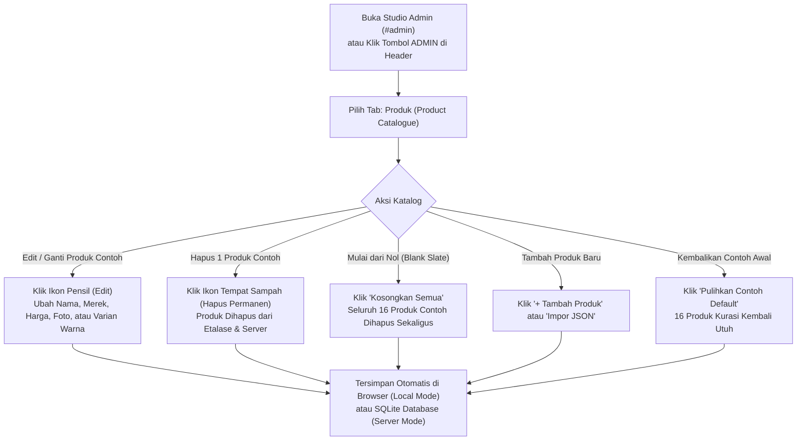

# SOLÈRE — Luxury Footwear Flagship & 3D Editorial Store

**SOLÈRE** adalah aplikasi web e-commerce sepatu mewah (*luxury footwear flagship*) bergaya editorial SSENSE yang menggabungkan **etalase 3D interaktif berbasis GSAP & Framer Motion**, **katalog kurasi 16 produk siap pakai (yang dapat diedit, diganti, atau dihapus penuh)**, **sistem keranjang & checkout (Direct Order & Midtrans Snap IDR)**, serta **Studio Admin (`#admin`) & Dashboard Member (`#member`)** dalam satu arsitektur modern.

---

## Daftar Isi

1. [Fitur Utama & Sistem Animasi 3D](#1-fitur-utama--sistem-animasi-3d)
2. [Product Requirements Document (PRD)](#2-product-requirements-document-prd)
3. [Arsitektur & Workflow Terstruktur](#3-arsitektur--workflow-terstruktur)
4. [Struktur Direktori Proyek](#4-struktur-direktori-proyek)
5. [Cara Mengedit, Mengganti, atau Menghapus Produk Contoh](#5-cara-mengedit-mengganti-atau-menghapus-produk-contoh)
6. [Panduan Menjalankan, Pengujian & Deployment](#6-panduan-menjalankan-pengujian--deployment)
7. [Konfigurasi Server: Google OAuth, SMTP & Midtrans IDR](#7-konfigurasi-server-google-oauth-smtp--midtrans-idr)

---

## 1. Fitur Utama & Sistem Animasi 3D

- **3D Orbital Showcase (`GSAP` + `Framer Motion`):**
  - Panggung 3 sepatu melayang (*center sharp*, *left/right depth-of-field blur*) dengan pelacakan perspektif 3D *real-time* (`rotationX`, `rotationY`, `rotationZ`, `scale`) menggunakan **GSAP (`gsap.to`)** serta bayangan lantai dinamis (*inverse ground shadow tracking*) dan animasi levitasi 3D halus.
  - Mendukung geser (*drag/swipe*), *trackpad horizontal wheel*, navigasi tombol panah, dan *auto-orbit* yang otomatis berhenti saat kursor berada di atas produk.
- **In-Place Morphing Detail & 3D Colorway Orbit:**
  - Klik **SEE MORE** atau sepatu utama untuk bertransisi langsung (*in-place morph*) ke tampilan detail editorial tanpa berpindah halaman.
  - Klik *swatch* warna untuk menggeser sepatu varian warna secara 3D ke kiri/tengah/kanan. Pilihan warna diingat secara otomatis saat kembali (`← Back`) ke *showcase* maupun *grid*.
- **SSENSE 3-Column Split Grid & Expandable Footwear Nav:**
  - Navigasi vertikal bertipografi *hollow stroke* (`RECHERCHER`, `HEELS`, `BOOTS`, `SNEAKERS`, `ALL SHOES`) khusus untuk etalase alas kaki mewah dengan sub-kategori kurasi (`Sneakers`, `Boots`, `Heels`, `Loafers`) dan kartu katalog berperspektif 3D.
- **3 Tema Atmosfer 3D (*Multi-Atmosphere Theme System*):**
  - Dapat diganti kapan saja melalui tombol **`STUDIO / IVORY / NOIR`** di header atas atau melalui **Admin Studio → Pengaturan**:
    1. **Gallery White (`#FFFFFF`)** — Studio putih bersih bergaya SSENSE (Default).
    2. **Warm Alabaster (`#F5F2EB`)** — Kertas editorial *ivory* hangat.
    3. **Atelier Obsidian (`#111312`)** — *Dark vault* mewah dengan aksen terang.
- **Katalog Eksklusif Merek Buatan Sendiri (SOLÈRE ATELIER):**
  - Menggunakan foto produk asli kurasi dengan pemrosesan **background removal transparan (.png)** dan watermark halus *SOLÈRE ATELIER*, tanpa nama merek komersial pihak ketiga. 100% fokus khusus alas kaki (*luxury footwear*).
  - Dilengkapi **15 produk alas kaki kurasi siap pakai** yang **dapat diedit, diganti foto/warnanya, diarsipkan, dikosongkan seluruhnya (`Kosongkan Semua`), atau dipulihkan kembali (`Pulihkan Contoh Default`)** langsung dari UI **Studio Admin (`#admin`)**.

---

## 2. Product Requirements Document (PRD)

### 2.1 Visi & Tujuan Produk
Menyediakan platform e-commerce sepatu kurasi kelas atas yang memadukan pengalaman visual interaktif 3D setara rumah mode global dengan alur belanja, manajemen inventaris, dan pemrosesan pesanan yang cepat, aman, dan siap digunakan di lingkungan produksi.

### 2.2 Peran Pengguna (*User Personas*)
| Peran | Deskripsi & Hak Akses |
| :--- | :--- |
| **Pengunjung (*Visitor*)** | Menjelajahi 3D Orbital Showcase, memfilter kategori/sub-kategori, memutar varian warna 3D, mencari produk, mengganti bahasa (`ID`/`EN`) & tema 3D (`STUDIO`/`IVORY`/`NOIR`), menyimpan *Wishlist*, dan menambahkan produk ke tas belanja (*Bag*). |
| **Member (*Customer*)** | Semua akses pengunjung + manajemen profil, buku alamat pengiriman, penggunaan kupon promo, checkout pesanan (Direct Order USD maupun Midtrans Snap IDR), pelacakan nomor resi, pembatalan pesanan sebelum dikirim, dan tiket bantuan pelanggan (*Client Care*). |
| **Admin (*Store Operator*)** | Akses penuh ke **Studio Admin (`#admin`)**: analitik pendapatan & unit terjual, tambah/edit/hapus produk & varian warna, *import/export* katalog JSON & CSV, kurasi produk beranda (*Best Sellers* otomatis atau manual), pemrosesan pesanan & input resi, manajemen kupon, serta identitas toko. |

### 2.3 Matriks Kriteria Penerimaan (*Acceptance Criteria*)
| Modul | Spesifikasi & Kriteria Penerimaan | Status |
| :--- | :--- | :--- |
| **3D Showcase & Orbit** | 3 sepatu tampil proporsional, *hover* menggerakkan rotasi 3D GSAP + bayangan terbalik, *auto-advance* berhenti saat *hover/focus*, mendukung `prefers-reduced-motion`. | Siap Digunakan |
| **Morphing Product Detail** | Transisi *in-place* dari *showcase*, *swatch* warna menggeser sepatu 3D secara horizontal, memori warna tersimpan saat kembali ke *showcase/grid*, akordion *Details / Free Delivery / Reviews*. | Siap Digunakan |
| **Manajemen Katalog (CRUD)** | Admin dapat menambah produk baru, mengubah foto/harga/stok/warna produk contoh, menghapus produk satu per satu, mengosongkan seluruh katalog 1 klik, memulihkan contoh 1 klik, dan ekspor/impor JSON. | Siap Digunakan + Teruji |
| **Keranjang & Validasi Stok** | Varian ukuran EU (20–55) & warna divalidasi terhadap total stok produk; kuantitas tidak dapat melebihi stok aktif. | Siap Digunakan + Teruji |
| **Checkout & Pembayaran** | Mendukung **Direct Order (USD)** dan **Midtrans Snap (IDR)** dengan *idempotency key*, kalkulasi ulang harga/kupon/ongkir di sisi server, dan pengembalian stok otomatis tepat satu kali saat pesanan dibatalkan. | Siap Digunakan + Teruji |
| **Autentikasi & Keamanan** | Sesi berbasis *HttpOnly cookie* (`SameSite=Strict`), *password hashing* `scrypt` + `timingSafeEqual`, Google Sign-In dengan verifikasi *nonce* sekali pakai, dan pemulihan sandi via kode email 15 menit. | Siap Digunakan + Teruji |

---

## 3. Arsitektur & Workflow Terstruktur

### 3.1 Workflow Pengalaman Belanja & 3D Showcase

```mermaid
flowchart LR
  A["Beranda: 3D Orbital Showcase\n(GSAP Tilt + Framer Motion)"] --> B{"Interaksi Pengguna"}
  B -->|"Klik Toggle Grid / Subkategori"| C["SSENSE 3-Column Split Grid\n(Filter: Sneakers, Boots, Loafers, dll.)"]
  B -->|"Klik SEE MORE / Sepatu Utama"| D["In-Place Morph Detail\n(3D Colorway Orbit + Galeri Editorial)"]
  C -->|"Klik Kartu Produk"| D
  D -->|"Pilih Warna, Ukuran EU & Add to Cart"| E["Shopping Bag Drawer\n(Validasi Stok & Varian)"]
  E -->|"Lanjut Checkout"| F["Autentikasi Member / Akses Cepat"]
  F --> G["Checkout: Alamat + Kode Promo + Ongkir"]
  G -->|"Mode Standar"| H["Konfirmasi Pesanan Langsung\n(Stok Berkurang Transaksional)"]
  G -->|"Mode Midtrans IDR"| I["Midtrans Snap Redirect + Webhook SHA512"]
  H --> J["Dashboard Member (#member)\n& Studio Admin (#admin)"]
  I --> J
```


### 3.2 Workflow Manajemen Katalog & Penggantian Produk Contoh (`#admin`)


---

## 4. Struktur Direktori Proyek

Seluruh kode aplikasi telah dirapikan tanpa file duplikat atau skrip yang tidak terpakai:

```text
solere-luxury/
├── public/
│   ├── editorial/              # Foto produk studio & aset pasangan sepatu 3D showcase
│   ├── fonts/                  # Font lokal (DM Sans, Barlow Condensed, Cormorant Garamond)
│   └── shoes/                  # Fotografi studio produk katalog (Gucci, Balenciaga, Prada, dll.)
├── scripts/
│   ├── build-full.mjs          # Build produksi dengan VITE_SERVER_MODE=true
│   └── dev-full.mjs            # Menjalankan API Server SQLite (5174) + Vite Dev (5175) bersamaan
├── server/
│   ├── app.mjs                 # HTTP Server Node.js + SQLite (node:sqlite), Auth, & CRUD API
│   ├── auth-services.mjs       # Verifikasi Google ID Token & pengiriman email pemulihan SMTP
│   ├── catalog.json            # Data awal (seed) 16 produk untuk database SQLite server
│   └── midtrans.mjs            # Klien Midtrans Snap API, kalkulasi IDR quote, & verifikasi SHA512
├── src/
│   ├── design/
│   │   ├── Showcase.tsx        # 3D Orbital Showcase (GSAP + Framer Motion), Split Grid, & Morph Detail
│   │   ├── showcase-data.ts    # Kalkulasi matematika orbit 3D & filter kurasi beranda
│   │   ├── Experience.tsx      # Shell utama aplikasi, navigasi, Theme Switcher, & halaman katalog
│   │   ├── Dashboard.tsx       # Studio Admin (#admin) & Dashboard Member (#member) dengan CRUD penuh
│   │   ├── Shopping.tsx        # Keranjang belanja (Bag), kalkulasi kupon, & alur Checkout
│   │   ├── MidtransCheckout.tsx# Antarmuka checkout Midtrans Snap IDR
│   │   ├── AuthEntry.tsx       # Login, registrasi, setup admin pertama, & akses cepat studio
│   │   ├── catalog.ts          # Definisi tipe produk & 16 produk contoh bawaan
│   │   ├── commerce.ts         # Logika murni keranjang, diskon kupon, ongkir, & validasi stok
│   │   ├── store.tsx           # State provider React + sinkronisasi otomatis LocalStorage / Server API
│   │   ├── backend.ts          # Helper fetch API ke backend server
│   │   ├── ui.tsx              # Komponen Modal, Status badge, Empty state, & eksportir CSV
│   │   └── styles.css          # Sistem desain lengkap + 3 tema atmosfer 3D + animasi
│   ├── App.tsx                 # Root komponen React (StoreProvider + Experience)
│   ├── main.tsx                # Entry point DOM React
│   └── index.css               # Entry stylesheet
├── tests/
│   ├── showcase.test.mjs       # Unit test orbit 3D, bestsellers, & filter kategori
│   ├── commerce.test.mjs       # Unit test kalkulasi keranjang, kupon, ongkir, & stok
│   ├── server.test.mjs         # Integration test autentikasi, RBAC, order, & hapus produk/kupon
│   └── auth-payment.test.mjs   # Integration test Google OAuth, reset sandi, & webhook Midtrans
├── .env.example                # Template variabel environment server
├── package.json                # Daftar dependensi & skrip npm
└── README.md                   # Dokumentasi tunggal terpadu & PRD (file ini)
```

---

## 5. Cara Mengedit, Mengganti, atau Menghapus Produk Contoh

Website ini hadir dengan **15 produk kurasi alas kaki mewah bermerek SOLÈRE ATELIER** menggunakan foto asli berlatar transparan yang siap dipakai. Ketika Anda ingin menambah, mengubah, atau mengelola produk, tersedia **2 cara mudah**:

### Cara A: Langsung dari Antarmuka Website (`Studio Admin`) — *Tanpa Koding*
1. Klik tombol **`ADMIN`** di pojok kanan atas header (atau buka URL `http://localhost:5173/#admin`).
2. Jika berjalan di mode lokal (`npm.cmd run dev`), masuk menggunakan formulir atau tombol **Akses cepat**.
3. Buka menu **Produk (*Products*)** di bilah kiri:
   - **Mengedit / Mengganti Produk:** Klik ikon **Pensil (`Edit`)** pada produk mana saja untuk mengganti nama, lini merek (`SOLÈRE ATELIER`, `SOLÈRE STUDIO`), kategori alas kaki (`Sneakers`, `Boots`, `Heels`, `Loafers`), harga USD/IDR, stok, ukuran EU, varian warna tambahan, maupun foto produk.
   - **Menghapus Satu Produk:** Klik ikon **Tempat Sampah (`Hapus permanen`)** pada baris produk lalu konfirmasi.
   - **Menghapus Semua Produk Sekaligus:** Klik tombol **`Kosongkan Semua`** di bagian atas tabel produk untuk memulai dari katalog kosong, lalu klik **`+ Tambah produk`** untuk memasukkan produk baru Anda.
   - **Ekspor / Impor Massal (JSON):** Klik **`Ekspor JSON`** untuk mengunduh struktur katalog saat ini, edit di editor teks, lalu unggah kembali melalui **`Impor JSON`**.
   - **Memulihkan Katalog Default:** Kapan pun Anda ingin mengembalikan ke-15 produk kurasi awal, cukup klik tombol **`Pulihkan Contoh Default`**.

### Cara B: Mengganti Data Bawaan di Kode Sumber (*Source Code*)
Jika Anda ingin mengganti daftar produk bawaan secara permanen di dalam repositori:
1. Taruh file foto sepatu Anda (format `.png` transparan) ke dalam folder `public/shoes/transparent/`.
2. Perbarui daftar produk di [`src/design/catalog.ts`](src/design/catalog.ts) dan [`server/catalog.json`](server/catalog.json).

---

## 6. Panduan Menjalankan, Pengujian & Deployment

> **Catatan Windows PowerShell:** Jika kebijakan eksekusi PowerShell memblokir `npm.ps1`, gunakan `npm.cmd` untuk menjalankan perintah di bawah ini.

### 6.1 Instalasi Dependensi
```bash
npm.cmd install
```

### 6.2 Mode Studio Lokal (*Frontend + Persistensi Browser*)
Cocok untuk pengembangan desain, pengujian *3D Showcase*, dan pengelolaan katalog langsung di browser:
```bash
npm.cmd run dev
```
- Buka `http://localhost:5173/` untuk *Storefront* 3D.
- Buka `http://localhost:5173/#admin` untuk *Studio Admin*.

### 6.3 Mode Full-Stack Server (*Frontend + Node.js API + Database SQLite*)
Mengaktifkan database SQLite (`data/solere.sqlite`), autentikasi sesi berbasis peran (*Admin* & *Member*), serta endpoint pembayaran Midtrans:
```bash
npm.cmd run dev:full
```
- Aplikasi berjalan di `http://127.0.0.1:5175` (terhubung ke API `http://127.0.0.1:5174`).
- Saat pertama kali dijalankan, terminal akan mencetak **First admin setup token**. Buka `#admin` untuk mendaftarkan akun Admin pertama menggunakan token tersebut.

### 6.4 Menjalankan Pengujian Otomatis & Build Produksi
```bash
# Menjalankan seluruh unit & integration test (showcase, commerce, server, auth-payment)
npm.cmd test

# Memeriksa tipe TypeScript dan membuat bundle produksi di folder dist/
npm.cmd run build

# Build full-stack (VITE_SERVER_MODE=true) dan jalankan server produksi
npm.cmd run build:full
npm.cmd start
```

---

## 7. Konfigurasi Publikasi via `.env` (Zero-Code Setup)

Anda hanya perlu menyalin [`.env.example`](.env.example) menjadi `.env` untuk mengatur identitas merek, tema bawaan, akun Admin otomatis, WhatsApp Concierge, Google OAuth, SMTP, maupun Midtrans tanpa perlu mengedit kode sumber:

```ini
# 1. Identitas Toko, Tema & Bahasa Bawaan (Frontend & Backend)
VITE_STORE_NAME=SOLÈRE
VITE_SUPPORT_EMAIL=care@solere.studio
VITE_DEFAULT_LANG=id
VITE_DEFAULT_THEME=gallery
VITE_ANNOUNCEMENT_ID=Pengiriman gratis untuk pesanan di atas US$250 · Koleksi Musim Baru
VITE_ANNOUNCEMENT_EN=Complimentary shipping on orders over US$250 · New Season Collection
VITE_WHATSAPP_NUMBER=

# 2. Server & Auto-Provisioning Akun Admin Pertama
PORT=5174
HOST=127.0.0.1
ADMIN_EMAIL=admin@solere.studio
ADMIN_PASSWORD=ganti-password-admin-kuat
ADMIN_NAME=SOLÈRE Studio Admin
SOLERE_SETUP_TOKEN=ganti-dengan-token-rahasia-anda

# 3. Opsional: Google Sign-In (Web Application Client ID)
GOOGLE_CLIENT_ID=xxxx.apps.googleusercontent.com

# 4. Opsional: SMTP untuk Email Kode Pemulihan Kata Sandi
SMTP_HOST=smtp.example.com
SMTP_PORT=587
SMTP_USER=apikey
SMTP_PASSWORD=rahasia
MAIL_FROM=SOLÈRE <no-reply@domain-anda.com>

# 5. Opsional: Midtrans Snap Payment Gateway (IDR)
MIDTRANS_SERVER_KEY=SB-Mid-server-xxxxxxxxxxxxxxxx
MIDTRANS_PRODUCTION=false
SHIPPING_STANDARD_IDR=25000
SHIPPING_EXPRESS_IDR=50000
SHIPPING_FREE_ABOVE_IDR=2000000
```

- **Midtrans Webhook URL:** Arahkan *Payment Notification URL* di dashboard Midtrans ke `https://domain-anda.com/api/payments/midtrans/notification`. Server memverifikasi tanda tangan `SHA512` dan mencocokkan nominal `gross_amount` secara otomatis sebelum mengubah status pesanan menjadi `paid`.
